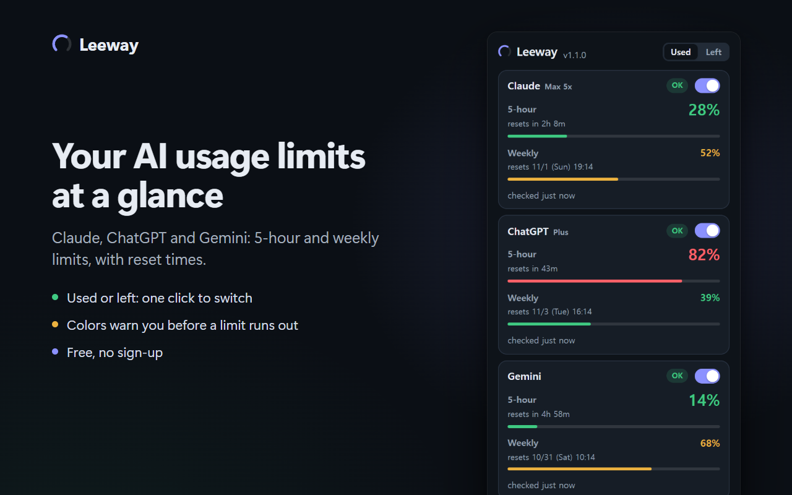

# Leeway

**Claude, ChatGPT and Gemini** usage — how much of the 5-hour and weekly limits you have used, or what is left — in Chrome's toolbar badge, a popup and an always-on-top overlay. Free and open source.

**[Add to Chrome (Chrome Web Store)](https://chromewebstore.google.com/detail/dlifmhanolkjflblnofiifgkffhkpgga)** · [Website](https://donasman.github.io/leeway/) · [한국어](https://donasman.github.io/leeway/ko/) · [Privacy policy](https://donasman.github.io/leeway/privacy/)



- Shows the percentage and reset time that your signed-in usage pages show — not a token-count estimate. Used by default; one click switches every number to what is left.
- No sign-in, and no cookie, password or API key to paste. No server, no analytics; session tokens are never stored.
- Toolbar badge for the service closest to its limit (color-coded), and a floating always-on-top overlay (Chrome 116+).
- Plan names (Max 5x, Plus, …), every Claude organization of your sign-in, UI in 6 languages.

> Unofficial project. Not affiliated with Anthropic, OpenAI or Google.

The extension uses the normal Chrome profile that is already signed in. It does not use Playwright, automate sign-in, or copy cookies/passwords out of the browser.

| Service | How usage is read | State |
|---|---|---|
| Claude | claude.ai authenticated internal usage endpoint | working |
| ChatGPT | chatgpt.com internal usage endpoint (the one its Settings > Usage page reads) | working — confirmed in a logged-in Chrome on 2026-10-15 (an account with a 30-day limit); accounts with 5-hour/weekly limits not yet seen |
| Gemini | gemini.google.com/usage page, read from an already-open tab | working — reading confirmed in a logged-in Chrome on 2026-10-16; needs that page open |

None of these are public, stable APIs. They may change without notice.

## Install from source (load unpacked)

The extension keeps the latest usage in its own storage and shows it in its popup and toolbar badge.

1. Open chrome://extensions, enable Developer mode, and choose **Load unpacked**.
2. Select this project's extension folder. If an older copy is loaded, remove or reload it.
3. In the extension popup, turn on Claude, ChatGPT and/or Gemini and allow the site permission it asks for. Gemini is read from an open gemini.google.com/usage tab — keep that page open (the **Gemini usage** button opens it) for its values to refresh.
4. Keep the normal Chrome profile signed in to those services. Values refresh every minute, and again when you open the popup or the Leeway window (unless they were read in the last 30 seconds); **Refresh** in the popup reads them again right away.

The floating overlay is built into the extension (click **Open overlay** in the popup, then **Float on top**, or just press Enter); it uses Chrome's Document Picture-in-Picture, so there is no separate app to install.

## Popup

For each service that is turned on, the popup shows how much of each limit is used and when it resets. The **Used | Left** switch at the top of the popup turns every number — popup, overlay and toolbar badge — into what is left, and back; the choice is kept. The 5-hour limit is the large number; an account without a 5-hour limit (e.g. ChatGPT Pro) shows its weekly limit there instead. 0% is shown as 0%; a value that could not be read is `?`.

- Colors follow what is left, whichever way the numbers read: green with half or more left, orange from 20% left, red below that — so 85% used is red. The bars are as long as the numbers shown.
- The plan (e.g. `Max 5x`, `Plus`) is shown next to the service name when the service reports it. Gemini does not, so it has none.
- One claude.ai sign-in can belong to several organizations (a personal plan and a Team workspace, say). Each one with chat limits gets its own block, named by its plan, so you can see which has how much left. The first one is the main value (the toolbar badge and the overlay's collapsed line).

- When a read fails, the last good values stay visible, dimmed, with how old they are. Hover the status label for the failure reason.
- Values older than 6 minutes (three missed refreshes) are dimmed; a good read that old is marked **Outdated**.
- Reset times come from the services as exact times. Only ChatGPT's page fallback gives relative "4시간 20분 후 초기화"-style text; the popup counts that down (in the current UI language) from when it was read.
- Turning a service on asks Chrome for that site's permission. If the popup closes while Chrome asks, allowing it still turns the service on.
- The UI is available in English, Korean, Spanish, Chinese (Simplified and Traditional) and Japanese. Chrome picks it from your browser language, falling back to English.

## Other Chrome profiles (optional)

To see several Claude (or ChatGPT, Gemini) accounts at once, sign in to each in its own Chrome profile and install Leeway in each. With the **Leeway helper** installed, every profile's popup and overlay also show the other profiles' usage.

1. Download `leeway-helper.exe` from the [latest release](https://github.com/donasman/leeway/releases/latest) (the popup's **Get the helper (Windows)** link goes straight to it) and run it once. It registers itself for your Windows user (no administrator rights) and copies itself to `%LOCALAPPDATA%\Leeway\helper`. Each release also has `leeway-helper.exe.sha256` to check the download against.
2. In each profile's popup, open **Experimental** and turn on **Other Chrome profiles** (Chrome asks for the "communicate with cooperating native applications" permission), then give the profile a name, e.g. `Work`.
3. Each profile then sends its own values on every refresh and shows the others' under its own. The toolbar badge still shows only this profile.

This is an experimental, Windows-only feature. The helper is not code-signed yet, so Windows SmartScreen may warn the first time it runs, and Windows 11 Smart App Control or a work PC's policy can block it.

Only the values the popup shows travel, through a file on your computer: no cookies, tokens or email addresses, and nothing leaves the computer. Remove it with `leeway-helper.exe uninstall`. Building the helper: see [helper/README.md](helper/README.md).

## Toolbar badge

The extension icon shows the main value of the service closest to its limit among those turned on, as a number without `%` — how much is used (e.g. `30`), or what is left (`70`) when the popup is switched to **Left**. Its colour follows what is left: green from 50% left, orange from 20 to 49% left, red below 20% left, grey when it is more than 6 minutes old. `?` means services are on but none has a value yet; no badge means none is on. Hover the icon for each service's value and reset time.

## ChatGPT

What is shown is what ChatGPT's Settings > Usage page shows: the plan limits shared by Codex, Work, workspace agents and ChatGPT for Excel. As that page says, ordinary chat conversations are not counted there.

Like Claude, ChatGPT is read in the background — no tab needs to be open. The extension asks chatgpt.com for a short-lived access token (with the browser's own sign-in) and then calls the usage endpoint ChatGPT's Settings > Usage page uses. The token is used for that one request and kept nowhere: not in extension storage, logs, or anything that leaves the extension. Of the answer, only the limit windows are read; the email and account ids in it are ignored.

Each limit is named by its length: 5 hours, weekly, or monthly (30 days, as on some accounts). The 5-hour limit is the main value; an account without one shows its weekly limit, and an account with only a monthly limit shows that. If a window's length or value can't be read, the read counts as failed rather than guessing which one is the main value.

If that endpoint fails (it is unofficial and may change), and a Settings > Usage page happens to be open, the extension reads that page instead. It never opens a tab for this and never reads conversation tabs, even with the usage dialog open over a conversation. From that page only the parsing steps are kept, not its text.

## Overlay

Click **Open overlay** in the popup — the same on any tab — to open the small Leeway window, which shows the same usage bars as the popup. Its **Float on top** button opens a small always-on-top window through Chrome's Document Picture-in-Picture — no separate app to install (needs Chrome 116+) — and then minimizes the Leeway window. The button has the focus when the window opens, so **Open overlay** then Enter does it too. Chrome lets only a click or key press in the Leeway window itself open that window, so the popup's click can't do both.

- Both refresh live, like the popup.
- Click the always-on-top window to collapse it to a single line; click again to expand. The window resizes to match.
- It stays on top of other windows while Chrome runs. Its title bar shows the extension's name and address (`chrome-extension://…`), not the site you are on.
- It belongs to the Leeway window: closing the Leeway window closes it too. Closing the always-on-top window brings the Leeway window back.
- **Open overlay** again brings the open Leeway window forward instead of opening another. It reopens where you last left it.

## Languages

The UI ships in English (default), Korean, Spanish, Chinese (Simplified and
Traditional) and Japanese, under `extension/_locales/`. Chrome selects the
locale from the browser language and falls back to English. Simplified Chinese
is in two folders with the same content: `zh_CN`, which the Chrome Web Store
lists as a language, and `zh`, which Chrome falls back to for other Chinese UI
locales. Traditional Chinese is `zh_TW`.

## Privacy

Leeway reads your usage from the sessions you are already signed in to, keeps it
on your device (`chrome.storage.local`), and sends it to no one. It has no
server, no analytics, and never stores page text, cookies, passwords, or
session tokens. See [PRIVACY.md](PRIVACY.md) for the full policy, including what
each permission is for.

## License

[MIT](LICENSE).

## Local checks

```
npm install          # once — test tooling only (jsdom)
npm test             # extension tests: parsers, snapshot, view, background, popup, ChatGPT parser, locales
node --check extension/background.js
```
